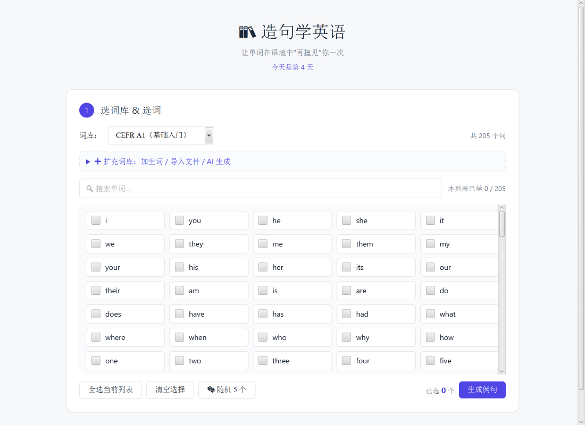
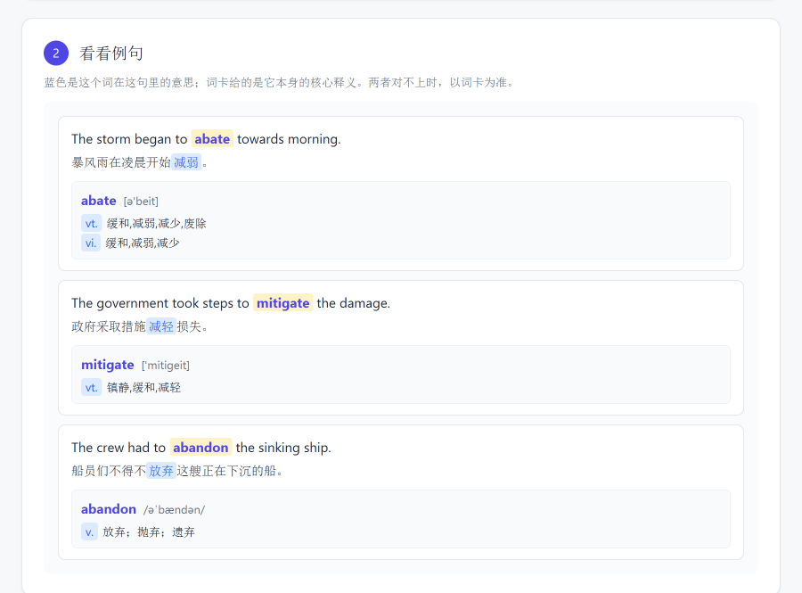
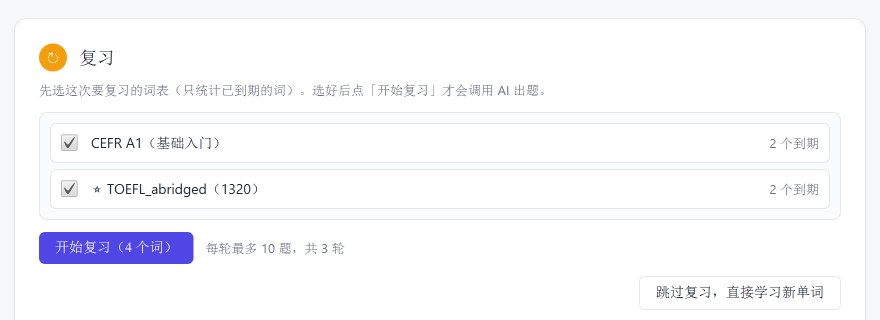

# 造句学英语（Create Sentence）

一款 Windows 桌面英语学习工具：从词库选词，让大模型为每个词生成带中文对照的例句，自己用关键词造句并获得纠错反馈，再按遗忘曲线复习。学习数据保存在本地，界面用 HTML/CSS/JS 构建，运行在 JavaFX WebView 中。

<p align="center">
  
</p>

## 功能

- **词库管理**：内置 4 个词库（CEFR A1/B1、IT、医学，共 557 词），支持生词本、导入 txt/csv、让 AI 按描述生成词库。
- **例句卡片**：英文例句里目标词高亮；中文翻译里对应义项标蓝；词卡给出音标、词性和释义（优先取本地词典，未命中时用模型结果）。
- **造句纠错**：用关键词造句，按【语法检查】【关键词用法】【改进建议】【小贴士】返回反馈；反馈区可以直接「修改句子」「再次检查」或「开始下一轮」。
- **间隔复习**：学习记录按“第 N 天”分桶，答对后间隔 2 / 4 / 7 / 15 / 30 / 60 天，答错次日重来；复习前可按词库筛选，每轮最多 10 题、三轮共 30 题。
- **本地优先**：学习记录与自定义词库存本地 JSON，除调用大模型外可离线使用；可打包为自带运行时的单文件 exe，目标机器无需安装 JDK。

## 界面

<p align="center">
  
  
</p>

## 技术栈

- Java 21（Temurin 21.0.12）+ JavaFX 21.0.5（WebView）
- Jackson 2.17.2（JSON）
- DeepSeek `deepseek-flash`（OpenAI 兼容 HTTP 接口）
- 构建：javac + PowerShell 脚本；打包：jpackage

### 架构说明

```
WebView（HTML/CSS/JS） ──window.api──▶ JsBridge（Java）
                                        ├─ DeepSeekClient：例句 / 纠错 / 复习出题
                                        ├─ ReviewOps / ReviewCore：复习调度
                                        ├─ ReviewStore：review-state.json
                                        ├─ WordBankRepository / CustomBankStore：词库
                                        └─ Dictionary：TOEFL_abridged.txt
```

界面层负责交互与渲染；窗口、桥接、大模型调用、持久化、词库与词典解析、复习调度都在 Java 侧。
复习调度在运行时由 Java 的 `ReviewOps` / `ReviewCore` 执行；`app/review-core.js` 保留一份等价的参考实现，
用于 Node 对拍测试（`tools/parity-dump.mjs` → `SelfTest`）。

## 快速开始

**系统要求**：Windows 10/11（x64）、JDK 21、Node.js 18+（仅用于下载依赖）、
能访问 Maven Central 与 DeepSeek API 的网络。项目里的脚本是 PowerShell / BAT，暂不支持 macOS / Linux。

获取代码（二选一）：

```powershell
# 方式一：git clone（公开仓库用 HTTPS，不需要登录）
git clone https://github.com/MD-4493/create-sentence.git
cd create-sentence
```

方式二：在仓库页面点 **Code → Download ZIP**，解压后进入目录（路径可以带空格，脚本已处理）。

然后执行：

```powershell
# 1) 一次性下载依赖（JavaFX + Jackson，约 43 MB，缓存在 lib/）
node tools/fetch-deps.mjs

# 2) 编译
powershell -ExecutionPolicy Bypass -File build.ps1

# 3) 配置 API Key（二选一）
#    app\.env，或 %APPDATA%\create-sentence\.env
#    DEEPSEEK_API_KEY=sk-你的key

# 4) 运行
powershell -ExecutionPolicy Bypass -File run.ps1
```

也可以直接双击 `start-java.bat`。仓库里没有预编译的 exe，需要按上面的步骤自行编译，
或使用 **Releases** 页面提供的打包产物（如果发布了的话）。

## 使用

1. **选词**：选择词库，搜索或全选单词（可随机 5 个），点「生成例句」。
2. **看例句**：每张卡片包含英文例句、中文翻译和词卡；蓝色是这个词在这句里的义项。
3. **造句**：用关键词写一个英文句子，点「检查我的句子」；反馈出来后可「修改句子」「再次检查」或「开始下一轮」。
4. **复习**：下次打开软件先进入复习。勾选要复习的词库（显示到期词数），点「开始复习」才会调用大模型出题；
   答完三轮或没有到期词后可以换词库或去学新词。

## 打包成独立程序

```powershell
node tools/fetch-deps.mjs
powershell -ExecutionPolicy Bypass -File package.ps1
```

输出 `out\dist\CreateSentence\CreateSentence.exe`（约 180 MB，内含 Java 运行时 + JavaFX + 前端资源）。
exe 默认不带控制台；排查启动问题时可加 `-Console` 生成带控制台的版本。

- `.env` 可放在 `out\dist\CreateSentence\app\.env`，或 `%APPDATA%\create-sentence\.env`。
- 使用 JDK 自带的 `jpackage`，`app-image` 不需要 WiX；要 `.msi` 安装包才需要。

## 测试

```powershell
powershell -ExecutionPolicy Bypass -File test.ps1
```

依次执行：

1. 编译；
2. 用 `app/review-core.js` 生成对拍数据（`tools/parity-dump.mjs`）；
3. Java 自测 86 项：词表解析、宽松 JSON、emoji 转义、复习算法（含与 JS 逐字段对拍、按词库筛选）、
   自定义词库、内置词库、旧数据导入、DeepSeek 请求/响应/错误映射；
4. WebView 冒烟测试（学习界面），截图 `out/smoke.png`；
5. WebView 冒烟测试（复习界面 + 真实大模型出题），截图 `out/smoke-review.png`；
6. 真实 DeepSeek 调用一次，验证 key / 端点 / 模型名。

冒烟结果里的 `reviewEngine` 字段会显示复习调度实际走的是 `java` 还是 `js`。

也可以只跑冒烟测试：

```powershell
powershell -ExecutionPolicy Bypass -File run.ps1 --smoke-test --data-dir="%APPDATA%\create-sentence" --snapshot="out\smoke.png"
```

## 项目结构

```
Create Sentence/
├── app/                      前端资源，打包时原样复制进 dist\...\app
│   ├── index.html  styles.css  renderer.js  review-core.js
│   ├── word-banks/           内置词库（4 个）
│   ├── TOEFL_abridged.txt    本地词典：word [音标] 词性. 释义
│   └── .env / .env.example   DeepSeek key（.env 不进 git）
├── src/main/java/com/sentence/
│   ├── App.java              入口：窗口、WebView、页面注入、冒烟测试
│   ├── JsBridge.java         9 个前端 API + 对话框 + 异步回传
│   ├── Settings.java         appRoot / 数据目录 / .env
│   ├── llm/                  HTTP 客户端、提示词、宽松 JSON
│   ├── review/               ReviewCore / ReviewOps / ReviewStore / LegacyImporter
│   ├── words/                词库、生词本、词典解析
│   └── SelfTest.java         自测（86 项）
├── src/main/resources/       bridge-core.js / bridge-patch.js
├── docs/                     skills 与说明图
├── tools/                    fetch-deps.mjs / parity-dump.mjs
├── build.ps1  run.ps1  test.ps1  package.ps1  start-java.bat
└── lib/  out/                依赖与构建产物（不进 git）
```

## 复习规则

- **天数**：每个自然日第一次打开软件 +1 天（`currentDay`），不按真实间隔累积。
- **分桶**：`days: { 桶号: [单词...] }`，桶号 N 的实际到期日是第 N+1 天（今天学的词明天才复习）。
- **词库归属**：`sources: { 单词: 词库id }`，学新词时记录；老数据没有该字段时按词库内容反推一次，
  推不出的归入「未分类（历史词）」。
- **答对**：间隔取 2 / 4 / 7 / 15 / 30 / 60 天，连对次数 +1；**答错**：排到明天，连对次数清零。
- **选题**：每轮取「最近到期的一天最多 5 个 + 最久没复习的一天最多 5 个」，最多 10 题，三轮一个循环；
  当天已复习的词不会重复出现。

## 数据与配置

| 内容 | 位置 |
|---|---|
| 学习记录 | `%APPDATA%\create-sentence\review-state.json` |
| 自定义词库 | `%APPDATA%\create-sentence\custom-banks.json` |
| API Key | `app\.env` 或 `%APPDATA%\create-sentence\.env` |
| 内置词库 / 词典 | `app\word-banks\`、`app\TOEFL_abridged.txt` |

首次运行会尝试从旧版 localStorage（LevelDB）目录只读导入学习记录，导入后不再依赖旧数据。

## 已知限制

- WebView 没有彩色 emoji 字体，📚🔍🎲 等显示为单色符号；
- 页面通过 `loadContent` + `<base href>` 加载，`document.location` 是 `about:blank`（不影响功能）；
- 滚动条使用 WebView 自带样式，与系统浏览器略有差异；
- 词卡音标沿用 `TOEFL_abridged.txt` 原写法（如 `[ə'beit]`），不是 IPA；
- 调用大模型需要联网。

## 开发注意

`*.ps1` 请保持纯 ASCII（注释也用英文）。Windows PowerShell 5.1 会把无 BOM 的脚本按 ANSI 解码，
中文注释可能把下一行“注释掉”，典型症状是 `--app-root=` 变空、启动时报「找不到 index.html」。
程序本身也做了兜底：没有 `--app-root` 时会依次尝试 `当前目录/index.html`、`当前目录/app/index.html`
及其上一级目录。

调试：

```powershell
powershell -ExecutionPolicy Bypass -File run.ps1 --debug
```
